# SolidCraft 98

[](https://github.com/raykholo/solidcraft98/actions/workflows/build.yml)

> **INTRODUCING SOLIDCRAFT 98 PROFESSIONAL EDITION.** Parametric solid
> modelling comes to the desktop PC! Sketch it, extrude it, drill it, and
> change your mind afterwards: every feature is fully editable, and
> everything built on it follows. A true 32-bit Windows application with a
> genuine Multiple Document Interface, a 16-colour toolbar, real-time*
> wireframe graphics, photorealistic** shading, Export for Rapid
> Prototyping and a Turbo button. Runs in 16 MB of RAM***. Fits on one
> floppy disk****.
>
> <sub>\* about 12 frames a second. \*\* flat. \*\*\* tested: 9.4 MB, see [Where it runs](#where-it-runs).
> \*\*\*\* packed with UPX, which came out in 1998, so it counts.</sub>

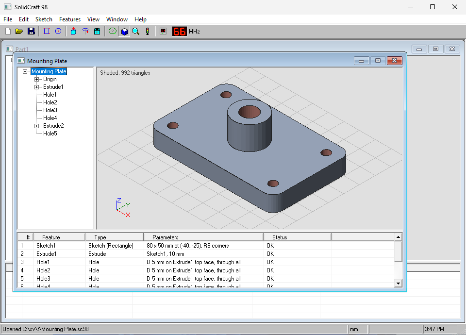

**Watch it:** [from an empty desktop to a 3D-printable part, on ReactOS (3:43, YouTube, turn on captions)](https://youtu.be/7t6-iIu5gdg)

[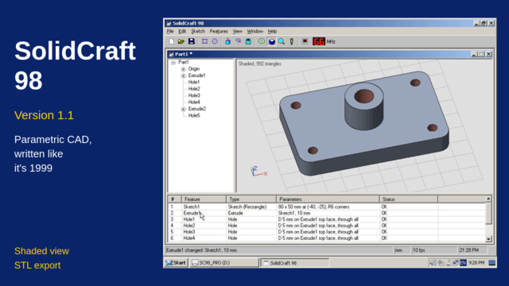](https://youtu.be/7t6-iIu5gdg)

SolidCraft 98 is a parametric CAD program written the way it would have
been written in 1999: in Visual Basic, with an MDI window, a `TreeView`, a
`ListView` in Report mode, and a wireframe viewport drawn with `Line`, one
edge at a time. The shaded view fills in every pixel itself.

It's a joke, but it works. You can sketch, extrude, revolve, drill holes,
put features on top of other features, change any of them later, open
designs from SolidCraft itself, save the part to a file nobody else can
read, and export it as an STL file that any 3D-printing slicer can.

> **SolidCraft 98 is a parody.** It is not affiliated with, endorsed by, or a
> replacement for SolidCraft, and it shares no code with it.

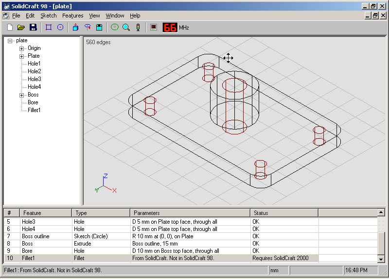

<sub>On ReactOS with the Classic theme, at 800 x 600: a design made in
SolidCraft, rebuilt and shaded in SolidCraft 98. The fillet is waiting for
SolidCraft 2000.</sub>

## Getting it

Download `SolidCraft98-<version>.zip` (the newest is 1.1.1) from the
[Releases page](../../releases), check its SHA-256 against the one listed
there if you like, unzip it anywhere,
and run `SolidCraft98.exe`. There's no installer and nothing to register:
one EXE, which is very un-1999 of it. It runs on Windows 10 and 11 and on
ReactOS. The EXE isn't signed, so Windows may say it "protected your PC":
choose More info, then Run anyway.

Or on a floppy, as was intended: each release also has a 1.44 MB disk image
(`SolidCraft98-<version>-floppy.img`) with the EXE packed by UPX to about
530 KB, so it all fits on one disk. Write it to a disk (or attach it to a
virtual machine) and run `A:\SC98.EXE`.

## Other editions

The same program, the same features and the same `.sc98` files, byte for
byte, in two more languages from the period (or near enough). Both are on the
[Releases page](../../releases) next to the Windows version.

| Edition | Runs on | Written in | Download |
|---|---|---|---|
| [Delphi Edition](delphi/) | Windows, ReactOS, Linux, Raspberry Pi | Object Pascal (Free Pascal and Lazarus) | `SolidCraft98-Delphi-1.1.1.zip` |
| [Linux and Raspberry Pi](freebasic/) | Linux, and a Raspberry Pi from 2014 (ARMv6) | FreeBASIC, every pixel drawn by hand | `SolidCraft98-Linux-1.1.1.tar.gz` |

## The book

[SolidCraft 98: The Definitive Guide](docs/manual/SolidCraft98-Definitive-Guide.pdf)
is the short, picture-heavy manual that would have come in the box: a tour
of the screen, your first part from start to finish, the Turbo button, and
a few hints. It's also a web page, `docs/manual/index.html`, to open in any
browser.

## What it can't do yet

- Sketches are rectangles and circles, flat, facing up. Revolve turns them
  about the Y axis. Holes go straight down from a top face.
- No booleans to speak of. In an STL, a body standing wholly on another's
  top face is joined to it; bodies that meet any other way stay separate
  (slicers merge them).
- Export is STL only. Parts save as `.sc98`, which nothing else reads.

## What's in it

- A grey MDI main window with a menu bar, a toolbar of hand-drawn
  16-colour icons, and a status bar.
- Each part opens in its own child window, which you can minimise inside the
  app by accident.
- A feature tree on the left and a timeline along the bottom.
- A viewport, wireframe or shaded. It starts isometric, looking at the
  front, right and top. Drag with the left button to orbit and the right
  button to pan; `+` and `-` zoom. S shades it, slowly.
- Commands: Sketch Rectangle (with rounded corners), Sketch Circle,
  Extrude, Revolve, and Hole. Plus Undo, Zoom to Fit and Regenerate.
- It's parametric. Double-click any feature to change its numbers, and
  whatever is built on it follows. Del deletes a feature (and, after
  asking, anything built on it).
- Sketches sit on the ground or on top of an extrude, and move with it.
- Holes go into the top of any extrude. "Through all" goes through
  everything stacked underneath.
- File > Export for Rapid Prototyping writes a binary STL, closed and
  facing out, for a 3D printer or a service bureau.
- Save and Open use `Put` and `Get` on a single `Type`. Open a file from a
  newer version and you're told so. Files from versions 3 and 4 are converted.
- Number boxes go through `CDbl` with no validation, so typing `20mm` gets you
  a genuine `Run-time error '13': Type mismatch`. It's caught and shown, not
  a crash.
- An About box and a splash screen, both drawn in code.

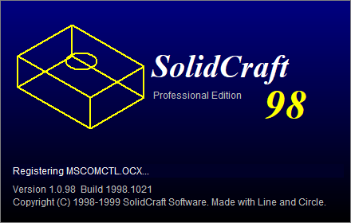

## Design your first part

A mounting plate: 80 x 50 x 6 mm with rounded corners, a hole in each corner,
and a boss in the middle with a bore through it and the plate. About five
minutes. (It's in `samples/Mounting Plate.sc98` if you'd rather look.)

1. **The plate outline.** Press R (Sketch, Rectangle). Width 80, Height 50,
   Corner X -40, Corner Y -25, Corner radius 6. Leave "On feature #"
   at 0, which means the ground. OK.
2. **The plate.** Press E (Extrude). Depth 6. OK.
3. **Corner holes.** Press H (Hole). Diameter 5, Depth 0 (all the way
   through), Centre X -32, Centre Y -17. OK. Do it three more times at
   (32, -17), (32, 17) and (-32, 17).
4. **The boss outline.** Press C (Sketch, Circle). Radius 10, Centre 0, 0.
   "On feature #": 2, which is the plate's number in the # column
   of the timeline. Height above that: 0. OK.
5. **The boss.** Press E. Depth 15. OK.
6. **The bore.** Press H. Diameter 10, Depth 0, Centre 0, 0. It goes on
   the boss, the last extrude, and because it's "through all" it carries on
   through the plate as well. OK.
7. **Change your mind.** Double-click Extrude1 in the timeline and make it
   8 mm. The boss moves up with the plate, and the bore still goes all the
   way through.
8. **Save.** Ctrl+S.
9. **Shade it.** Press S, and watch it render a few rows at a time.
10. **Print it.** File > Export for Rapid Prototyping (*.stl). Open the STL
    in any slicer (PrusaSlicer, Cura, OrcaSlicer...) and print it.

Tips:

- Drag in the view with the left button to orbit, the right button to pan.
  I puts it back to isometric; F fits it to the window.
- A hole goes on the extrude you've selected in the tree or the timeline,
  or on the last one if nothing is selected. A new sketch sits on the
  selected extrude too.
- Number boxes do arithmetic: 80/2, 25+3.5. They don't do units, and
  they'll tell you so.

## Shaded, and Export for Rapid Prototyping

**View > Shaded** (S, or the cube on the toolbar) draws the part as solid
surfaces. It's a software renderer, as was the custom: every triangle is
filled in pixel by pixel with a depth for each pixel, so near things hide
far things properly, and lines go where faces meet at a corner. Then the
picture goes up a few rows at a time, top to bottom. It takes about a
second and a half, on purpose. While you orbit, the view is wireframe; it
shades again when you let go.

**File > Export for Rapid Prototyping (\*.stl)** writes the part for a 3D
printer: a binary STL in millimetres, closed, every triangle facing out,
holes cut all the way through, and the part moved into the all-positive
corner of space as the 1989 format asked. A boss standing on a plate is joined to it, so the two come out as
one solid. Circles become 64-sided. The samples open in PrusaSlicer as
manifold and slice without repairs.

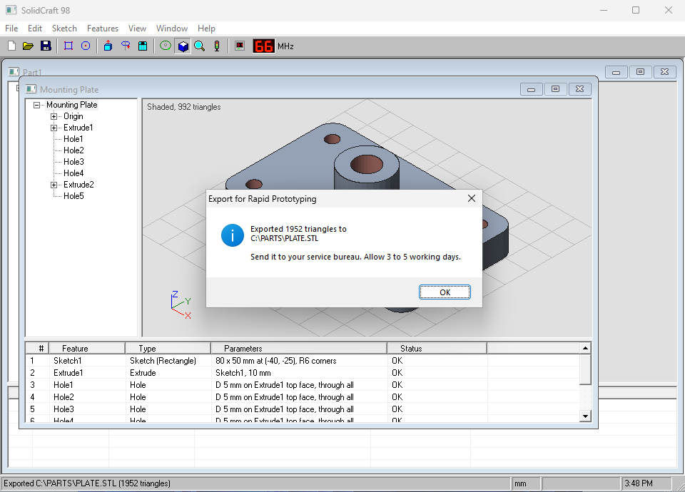

## Opening SolidCraft designs

File > Open also takes a design from SolidCraft itself (`.solidcraft`, or a
plain-JSON design). SolidCraft 98 reads the design's feature history and
rebuilds what it can:

| In SolidCraft | In SolidCraft 98 |
|---|---|
| A sketch on the XY plane, or on a flat face that points up, of rectangles (plain or rounded) and circles | Sketches; one on a face sits on the extrude under it |
| Extrude, new or join, in either direction or symmetric | Extrude |
| Circles inside an extruded outline | Holes through that extrude |
| A cut extrude of circles into a top face | Holes |
| A simple or drilled hole, straight down | Hole |
| Revolve about the sketch's Y axis | Revolve |

Anything else (fillets, chamfers, patterns, sketches on side planes...) stays
in the timeline with the status "Requires SolidCraft 2000", and the part opens
with what's left. A feature comes over whole or not at all: if part of it
can't be rebuilt exactly, all of it waits for SolidCraft 2000.

The design is read, not changed. Save writes a new `.sc98`. Try the three
`.solidcraft` files in `samples/`.

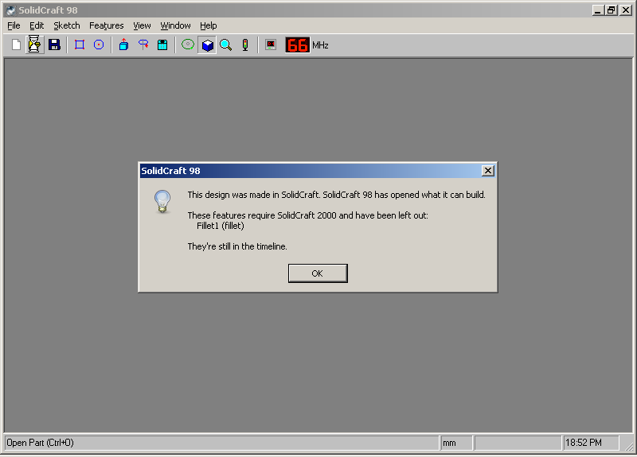

## Turbo

The toolbar has a Turbo button, with an LED next to it. It doesn't do what
you'd hope.

<details>
<summary>Turbo, and the other things in here (spoilers)</summary>

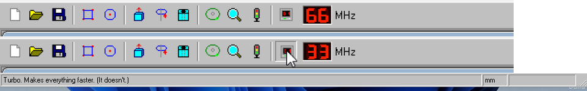

Like the button on the front of a 1990s PC, except backwards. The LED next to
it reads 66 MHz normally and 33 MHz with Turbo on, and Turbo switches on the
authentic 1999 behaviour. With Turbo off, everything just works.

With Turbo on:

- **Regenerate** (F5) says "Did not converge. Try again." twice, then
  succeeds on the third press. The solver uses a `Variant`.
- **Orbit** is capped at 4 frames a second, and the status bar says so.
- **Shaded** takes four seconds instead of one and a half: Turbo quality.
  Every pixel is rendered twice, to be sure.
- **"20mm" in a number box** escalates: Type mismatch, then Still a type
  mismatch, then "It's a TextBox, not a mind reader", then a tip about
  `Val()`. On the fifth try it gives up and takes 20.
- **Cal's "Don't show me this tip again"** pins the tip in the corner
  instead, so you won't miss it. Its x does close it.
- **Dividing by zero** in a number box (they take arithmetic, so `40/0`)
  gets a full-screen blue fatal exception. Press any key; the part is fine.
  With Turbo off it's a plain run-time error 11.
- **File > Send To 3 1/2 Floppy (A:)** saves the part to the hard disk, then
  "copies" it to three floppies, asking for each disk. Turbo saves include an
  uncompressed preview bitmap, for speed.
- **Y2K**: on 31 December 1999 by the PC's clock, at midnight, every
  dimension becomes 19100 mm. Start with `SolidCraft98.exe /Y2KTEST` to see
  it a minute after launch without touching the clock.
- **DLL Hell**: Help > About, Shift-click the logo. A setup program copies
  MSCOMCTL.OCX over itself to 112% and asks you to restart Windows.

Either way:

- **Cal**, the caliper assistant, notices when you sketch a rectangle.
- **Type WIN98** in the About box for the demo-scene credits.
- **The Konami code** in the viewport (up up down down left right left right
  B A) spins the part at full speed for three seconds: "60 fps (lying)".
- **File > Publish to Web** writes a home page for the part: a marquee, a hit
  counter, an animated "under construction" GIF and a picture of the part.

Every one of these is only drawn on screen. Nothing touches system files,
the clock or a disk drive, and no design is ever lost.

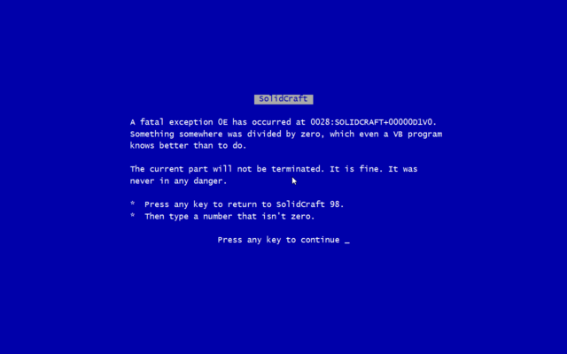

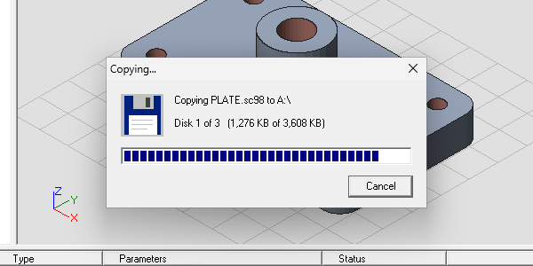

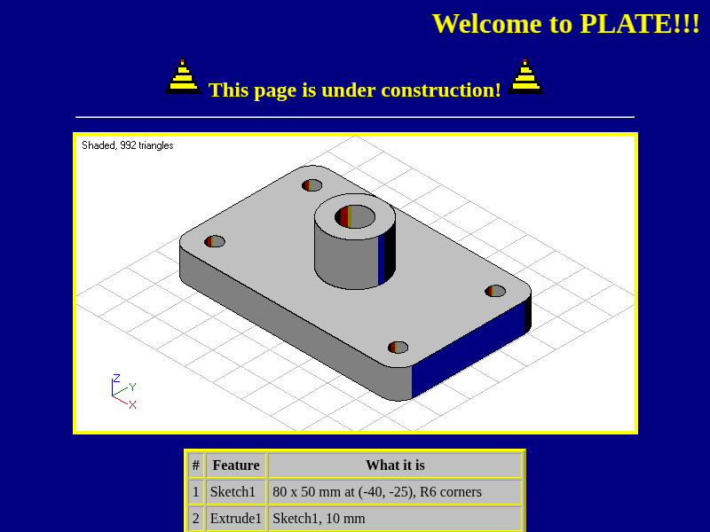

</details>

## Keys

| Key | Command |
|---|---|
| Ctrl+N / Ctrl+O / Ctrl+S | New, Open, Save |
| Ctrl+Z | Undo last feature |
| R, C | Sketch rectangle, sketch circle |
| E, V, H | Extrude, Revolve, Hole |
| I, F | Isometric view, Zoom to fit |
| S | Shaded (again for wireframe) |
| Enter, or double-click | Edit the selected feature |
| Del | Delete the selected feature |
| + / - | Zoom in and out |
| F5 | Regenerate |
| F1 | Help (it isn't installed) |

## Everything is a command

In 1999 the Extrude logic would have lived in `cmdExtrude_Click`, been
copy-pasted into `mnuExtrude_Click` and again into `Form_KeyDown`, and the
three copies would have drifted apart by the second release.

Here the joke stays in this paragraph. The toolbar, the menus and the
keyboard all call `RunCommand "Extrude"` in `modCommands.bas`, and there is
one copy of each command.

## Source

The source is plain VB6 text: `src/SolidCraft98.vbp` plus `.frm` and `.bas`
files. There are no `.frx` files: the icons, the logo and the splash are
drawn at startup.

| File | What it does |
|---|---|
| `frmMain.frm` | MDI frame: menus, toolbar, status bar |
| `frmPart.frm` | A part window: tree, viewport, timeline |
| `frmParams.frm` | The one dialog every command uses for its numbers |
| `frmAbout.frm`, `frmSplash.frm` | About box and splash |
| `modCommands.bas` | Every command, once |
| `modModel.bas` | The design `Type`, the feature list, Save and Open |
| `modKernel.bas` | Turns features into edges (the "geometry kernel") |
| `modView.bas` | Projection, orbit, wireframe drawing |
| `modMesh.bas` | Turns the part into closed triangle meshes |
| `modShade.bas` | The shaded view: a software renderer |
| `modStl.bas` | Export for Rapid Prototyping (binary STL) |
| `modBars.bas` | The toolbar and status bar, drawn in PictureBoxes |
| `modIcons.bas` | Toolbar icons as 16x16 text pixel art |
| `modImport.bas` | Opening SolidCraft designs |
| `modZip.bas`, `modJson.bas` | A ZIP reader with its own Deflate decoder, and a JSON parser |
| `modClassic.bas` | Keeps the classic look on modern Windows; coloured text |
| `modTurbo.bas` | The Turbo button and the 1999 behaviour behind it |
| `modExpr.bas` | Arithmetic in number boxes |
| `modGif.bas`, `modPublish.bas` | GIF writer and Publish to Web |
| `frmFloppy`, `frmFatal`, `frmSetup`, `frmCal`, `frmCredits` | The easter eggs |

The toolbar and status bar are drawn by hand rather than taken from
MSCOMCTL.OCX, because that OCX doesn't ship with current Windows. The
TreeView and ListView are the MSCOMCTL ones as far as VB6 is concerned.

## Building from source

The source is the VB6 project, `src/SolidCraft98.vbp`. Two ways to build it:

**With twinBASIC** (free, and what the release is built with):

1. Install [twinBASIC](https://twinbasic.com) on Windows, and Python 3 on any
   machine.
2. Convert the VB6 project to a twinBASIC source folder, and pack it:

   ```
   python3 tools/vb2tb.py src/SolidCraft98.vbp build/src
   python3 tools/impexp.py import build/SolidCraft98.twinproj build/src --overwrite
   ```

3. Build it, 32-bit:

   ```
   twinBASIC.exe build\SolidCraft98.twinproj --buildAndExit32
   ```

   The EXE lands in `build\Build\SolidCraft98.exe`, with the manifest and
   the icon built in. If the build hits a compile error the IDE stays open
   in the background: open the `.twinproj` in the IDE to see the errors.

`vb2tb.py` does what twinBASIC's own VBP import does, without the IDE: it
turns each `.frm` into twinBASIC's form format, converts twips to pixels,
maps the MSCOMCTL TreeView and ListView onto twinBASIC's built-in common
controls, and embeds the manifest and the icon. `impexp.py` is twinBASIC's
own MIT-licensed import/export tool.

**On GitHub**, every push builds on a Windows runner (`.github/workflows/build.yml`,
which runs `tools/ci/build.ps1`): twinBASIC's first-run questions are answered
in advance, the build has a time limit, and it fails if the UPX-packed EXE no
longer fits on a 1.44 MB floppy. A `v*` tag publishes the zip and the floppy
image as a release.

**With Visual Basic 6**, if you have it: open `src/SolidCraft98.vbp`,
File > Make SolidCraft98.exe, and put `SolidCraft98.exe.manifest` next to
the EXE. (Untested: VB6 isn't something you can download any more.)

## Where it runs

Windows 11, where it was built and tested, and ReactOS 0.4.16, the free
NT-compatible operating system. On ReactOS, with the Classic theme at
800x600, it looks the way it was always meant to: grey 3D chrome and blue
gradient title bars. The same `.sc98` files open on both. On a screen too
small for the window it starts maximised.

SolidCraft98.exe uses about 9.4 MB of RAM, with a part open and shaded.
The 1 GB in its About box is the PC's memory, reported the 1998 way.

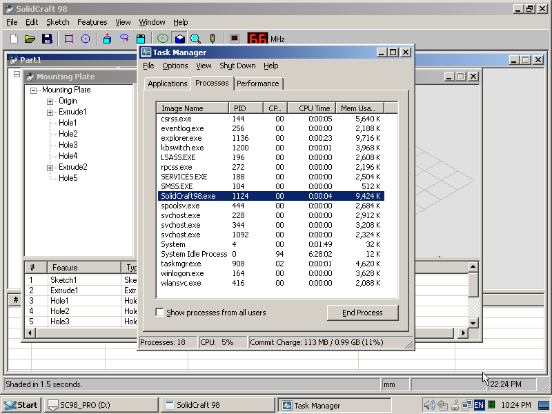

## Tools

| Tool | What it does |
|---|---|
| `tools/vb2tb.py` | VB6 project to twinBASIC source folder |
| `tools/impexp.py` | twinBASIC's project packer (MIT, unchanged) |
| `tools/pixpng.py` | Renders the icons in `modIcons.bas` to a PNG |
| `tools/mkico.py` | Makes `SolidCraft98.ico` from the "App" icon |

## Licence

MIT. See [LICENSE](LICENSE) and [NOTICE](NOTICE). The EXE is compiled with
twinBASIC, which is not part of this project.

SolidCraft 98 is a parody, and not affiliated with or a replacement for
SolidCraft.
