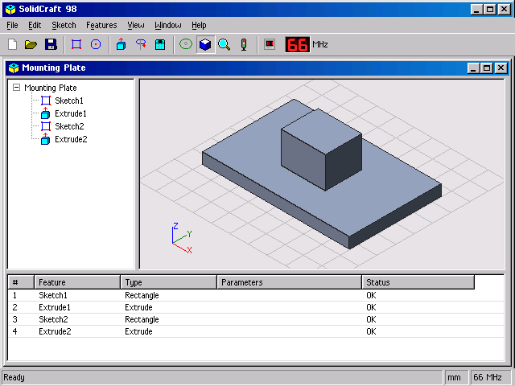
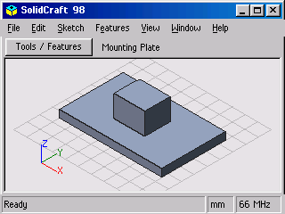

# SolidCraft 98 — Embedded Edition

The same grey desktop, on a smaller desk. A preview of SolidCraft 98 for
small screens, with a desktop demo for trying it out.




## Try it

From `rust/`:

```sh
cargo run -p sc98-desktop --release
cargo run -p sc98-desktop --release -- --compact
cargo run -p sc98-desktop --release -- --compact --painter --indexed
```

Drag with the left mouse button to orbit; right-drag to pan. The wheel,
`+` and `-` zoom. `S` switches shaded/wireframe, `I` restores isometric,
`F` fits the part. Click menus or use Alt+F/E/S/T/V/W/H, arrows and Enter.
`Tab` opens the compact Tools / Features drawer; Escape closes it. Up/Down
select a feature; Enter opens its number dialog. Number dialogs accept
numeric input, Backspace, Tab, Enter and Escape. Large compact dialogs have
three fields per page; **More fields >** and Tab reach every field.

The demo uses a small mounting plate with a rectangular boss. Modelling,
file operations and feature editing await the `sc98-core` adapter; the UI
returns commands and accepted parameters to its host. The current demo
neither reads nor writes designs. Its File commands display a message box.

## Drawing and integration

`sc98-pixels` is `no_std`, forbids unsafe code, and uses no heap. Its only
dependency is `libm`. Font widths, all 256 glyphs and all 17 icons are const
ports of the FreeBASIC artwork, reproduced by `python3 tools/port-art.py`.
The Windows Standard colours, six bevel styles, dotted tree connectors,
title gradients, menus, toolbar, MHz display, buttons, tree, timeline,
status bar, message boxes and number dialogs follow the FreeBASIC edition.
RGB565 quantization and the compact arrangement necessarily change some
pixels; these goldens establish this port's baseline, not cross-language
pixel equivalence.

Implement `model::Part` for a core adapter: a borrowed name, a slice of
`Feature { name, kind }`, and a slice of `Triangle { vertices, normal,
color, face }`. Geometry uses the single `Scalar = f32` alias. Units are
millimetres; Z points up. Normals point out. Triangles on one surface share
a nonzero face ID; distinct surfaces have distinct IDs. This suppresses
coplanar wireframe diagonals and draws shaded face boundaries. `DemoPart`
is an independent const-data adapter for bring-up and tests. The graphics
crate doesn't depend on the model crate: any type implementing `Part` works.

Implement `framebuffer::Framebuffer` (`width`, `height`, `set`; overridable
`fill` and RGB565 `blit`) for a display driver, or borrow a slice through
`Rgb565` / `Indexed16`. Indexed pixels use one byte each, with the reference
QB 16-colour palette. Arbitrary RGB565 colours are mapped to their nearest
palette entry. Coordinates and Canvas clips stay inside the framebuffer.
No unsafe framebuffer boundary is needed for these memory backends.

`App::new(layout, part)`, `App::event` and `App::render` share layout and hit
testing between hosts. `Action::Command` identifies commands and
`Action::Parameters` carries the accepted numeric fields. The host owns
model mutation, file dialogs and expression evaluation. Window decorations
are drawn; OS-style MDI dragging, resizing and multiple documents are outside
this demo. `sc98-desktop` uses minifb's X11 backend and a persistent buffer;
no toolkit paints any controls.

The view uses the reference orthographic projection (135° yaw, 35.264°
pitch), 10 mm grid, axis triad and viewer-relative flat lighting. Select
`Visibility::Depth` for interpolated per-pixel depth plus face IDs, or
`Visibility::Painter` for centroid sorting without a depth buffer. Painter
sorting is approximate for intersecting triangles. Degenerate, non-finite
and extreme projected triangles are skipped. Wireframe needs no scratch
memory. Caller-owned scratch requirements are:

| Storage | Bytes |
|---|---:|
| 320 × 240 RGB565 framebuffer | 153,600 |
| 320 × 240 indexed framebuffer | 76,800 |
| Depth + face IDs | viewport width × height × 6 |
| Painter order for 300 triangles | 1,200 on RV32; 2,400 on this PC |

The desktop allocates depth buffers only in depth mode, and an indexed
buffer only in indexed mode. The renderer itself does not allocate. See
[validation and measurements](docs/validation.md) for this machine's results.

## Checks and screenshots

Test one crate at a time:

```sh
cargo test -p sc98-pixels --test graphics
cargo clippy -p sc98-pixels --all-targets -- -D warnings
cargo test -p sc98-desktop --test render
cargo clippy -p sc98-desktop --all-targets -- -D warnings
cargo fmt --all --check
```

Seven checked-in little-endian RGB565 buffers cover the artwork, controls,
number and message dialogs, and depth/painter/wireframe views. Tests also
check clipping, palette conversion, short buffers, non-finite meshes,
intersecting surfaces, menu dispatch, drawer controls and all seven numeric
fields in both layouts. Desktop tests decode and compare the two PNGs,
exercise modal/drawer rendering and indexed output, and time a distinct
300-triangle cylinder (100 top triangles and 200 wall triangles).

Only regenerate baselines after reviewing the pixels:

```sh
UPDATE_GOLDENS=1 cargo test -p sc98-pixels --test graphics
UPDATE_SCREENSHOTS=1 cargo test -p sc98-desktop --test render screenshots_and_colour_modes
cargo run -p sc98-desktop --release -- --screenshot docs/desktop-640x480.png
cargo run -p sc98-desktop --release -- --compact --screenshot docs/desktop-320x240.png
cargo run -p sc98-desktop --release -- --benchmark
```

Screenshots render the actual framebuffer to PNG without an X server. For
a window smoke check, use `xvfb-run -a` on the built executable with
`--frames 3` (repeat with `--compact`).

For a bare-metal release and a linked size probe:

```sh
rustup target add riscv32imc-unknown-none-elf
cargo build -p sc98-pixels --release --target riscv32imc-unknown-none-elf
cargo build -p sc98-pixels --example size_probe --release --target riscv32imc-unknown-none-elf
size target/riscv32imc-unknown-none-elf/release/examples/size_probe
```

`size_probe` retains both layouts and framebuffer formats. It is a link-size
probe, not startup code or a board support package: its large local buffers
need a host-provided stack. A library `.rlib` archive size includes Rust
metadata and bitcode and is not a firmware flash-size estimate.
